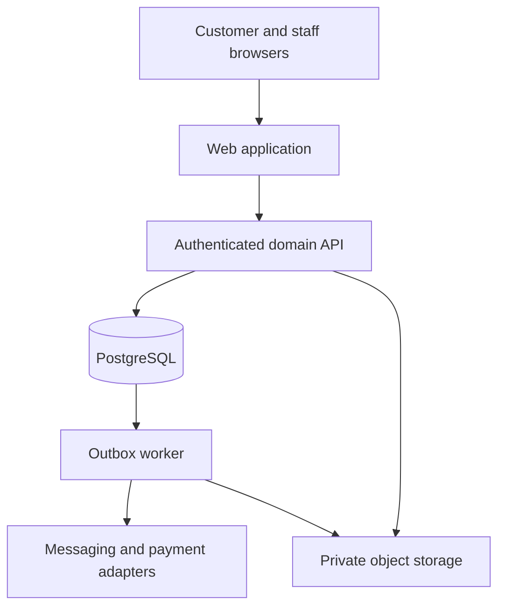
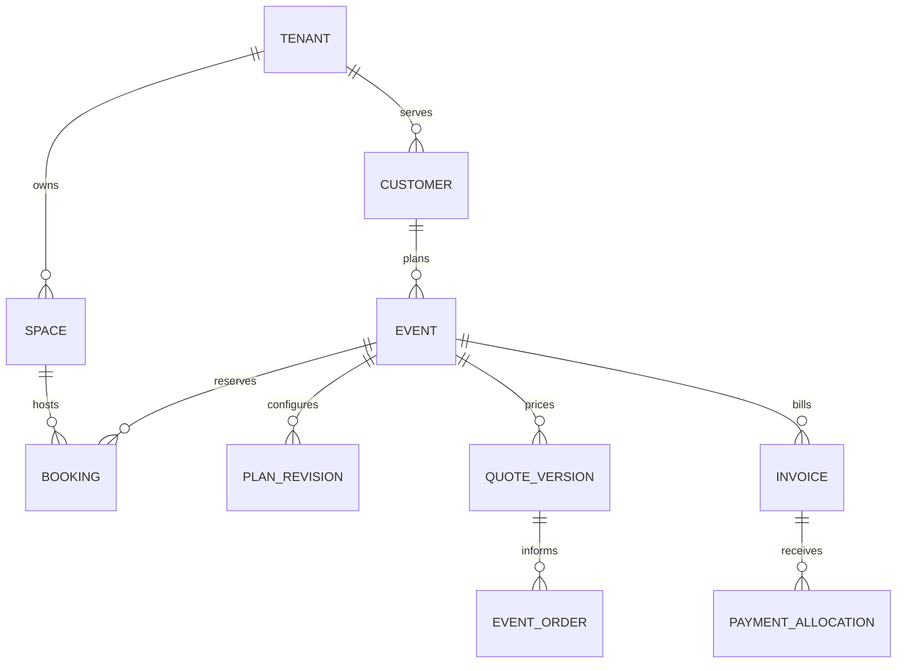

# Wedding Venue Platform Technical Architecture

Version 1.0 | 8 November 2026 | Implementation proposal

## 1 Architecture decision

Build a modular monolith with a separate web frontend, API process and background worker. Keep commercial transactions in one PostgreSQL database. Use module boundaries and public interfaces so expensive work can move to a separate service later without splitting booking integrity across several databases at the start.

The architecture serves many venue businesses. A tenant is one business, not one marquee. A tenant can own several branches; each branch has spaces and physical resources. A customer or staff account can belong to more than one tenant, but every request uses exactly one authorised tenant context. Platform administration is a separate privileged surface.

### 1.1 System topology



The public website can be cached at the edge. Availability, pricing, identity, private event records and financial actions require the API. The browser never holds a database service credential. Payment and messaging providers are optional adapters; their outages do not undo an already committed booking.

### 1.2 Recommended stack

| Layer | Recommendation | Reason and boundary |
| --- | --- | --- |
| Web | Next.js and React with strict TypeScript | Search-friendly venue pages and reusable customer and staff interfaces |
| UI | Accessible semantic components, design tokens and a small shared component library | Consistency, keyboard operation and easy rebranding |
| API | NestJS on a supported Node.js LTS release | Explicit domain modules, validation, guards and OpenAPI contracts |
| Database | Managed PostgreSQL on a supported stable major version | Transactions, range exclusions, relational reporting and optional RLS defence |
| Persistence | Drizzle ORM plus reviewed SQL migrations | Typed queries with explicit SQL for database-specific constraints |
| Contracts | Zod schemas and generated OpenAPI client types | Runtime validation and consistent inputs without importing database rows into the UI |
| 3D | Three.js, React Three Fiber and selected Drei helpers | Browser scene graph, instancing and an established performance approach [R10] |
| 2D | SVG editor for moderate layouts, Canvas rendering if profiled volume requires it | Accessible controls and printable to-scale layouts from common data |
| Client data | TanStack Query for server state; Zustand for local editor state | Distinguish persistent records from unsaved visual interactions |
| Spatial work | Pure TypeScript geometry package plus Web Worker | Deterministic placement and validation without blocking input |
| Jobs | PostgreSQL transactional outbox with leased workers initially | Durable jobs without requiring a second consistency authority |
| Storage | S3-compatible private storage and CDN for approved public assets | Scoped access, lifecycle rules and efficient asset delivery |
| Authentication | Maintained OIDC identity provider with staff MFA support | Avoid building password and recovery systems from scratch |
| Quality | Vitest, real PostgreSQL integration tests, Playwright, axe and k6 | Domain invariants, full user flows, accessibility and load verification |
| Operations | Containers, infrastructure as code, OpenTelemetry and central logs | Repeatable deployment and traceable incidents |

Pin compatible stable versions when implementation starts, commit lockfiles and record choices in architecture decision records. This document recommends capabilities, not unverified exact version combinations. A hosted Next.js frontend and containerised API are possible; keep hosting portable through standard HTTP, PostgreSQL and object storage contracts.

## 2 Repository and dependency boundaries

```text
apps/
  web/                       public website, customer portal, staff workspace
  api/                       transport, auth guards and module composition
  worker/                    jobs, integrations and document generation
packages/
  contracts/                 public schemas, error codes and API types
  domain/
    tenancy/                 membership, scope and business policies
    crm/                     enquiries, contacts and appointments
    venues/                  spaces, shells, resources and closures
    catalogue/               dishes, packages, stages and rates
    planning/                configuration and approved revisions
    booking/                 holds and resource claims
    finance/                 quotes, invoices, payments and refunds
    operations/              event orders, tasks and assignments
    inventory/               stock, reservations and procurement
    notifications/           preferences, delivery intent and templates
    reporting/               defined read models
  spatial/                   coordinates, layout engine and validation
  renderer/                  3D view, 2D view and asset adapters
  ui/                        accessible components and tokens
  database/                  schema, repositories and migrations
  observability/             trace, log and metric helpers
  test-support/              factories and integration fixtures
docs/
  adr/                       decisions and tradeoffs
  api/                       generated contracts
  runbooks/                  restore, deploy, rollback and incidents
```

Domain packages contain rules and use cases. They do not import React, Next.js, NestJS, rendering code or provider SDKs. Modules access another module through its public application service or published event; avoid cross-module table mutation. Read models may join data through reviewed queries without becoming a second write path.

Keep component, transport, application service, pure domain rule and persistence responsibilities distinct. Do not put pricing or booking confirmation in a page component. Avoid an excessive abstraction layer for trivial code; isolate dependencies where substitution or a business boundary justifies it.

## 3 Domain model and ownership

All tenant-owned tables carry tenant_id. Related records use composite foreign keys containing tenant_id so a valid identifier from another tenant cannot be attached accidentally. UUIDs identify records; names and slugs are display attributes, never authorisation controls.

| Aggregate | Key records and fields | Critical invariant |
| --- | --- | --- |
| Organisation | tenant, branch, membership, role, scoped_permission | A request has a verified active membership and venue scope |
| Customer | customer, contact, event_project, collaborator_grant | Collaborators can access only explicitly granted events |
| CRM | enquiry, source, lead_activity, visit_appointment | Appointments use staff availability and have an assigned owner |
| Venue | space, atomic_resource, space_resource_map, closure | Combined spaces claim every affected atomic resource |
| Venue shell | shell_version, boundary, obstacles, entrances, protected_zones | Published measured geometry is immutable and has a unit system |
| Catalogue | dish, package_version, choice_group, stage_version, extra_version | Only approved published versions can enter a new quote |
| Plan | configuration, configuration_revision, approval | Approved revisions refer to fixed shell and catalogue versions |
| Booking | hold, booking, resource_claim, booking_policy_version | No overlapping active claims for one exclusive resource |
| Commercial | quote_version, quote_line, contract_acceptance, change_order | Issued price and accepted terms are immutable |
| Receivables | invoice, invoice_line, credit_note, instalment | Posted documents change through adjustments, not silent edits |
| Money | payment, payment_verification, allocation, refund, ledger_entry | Provider event and receipt uniqueness; allocations do not exceed verified funds |
| Delivery | event_order_revision, task, checklist, acknowledgement, incident | Departments know which approved revision they are executing |
| Inventory | stock_item, stock_pool, stock_reservation, stock_movement | Reserved quantities respect the time-dependent available capacity |
| Procurement | supplier, purchase_order, goods_receipt, vendor_bill | Bills and deliveries reconcile to authorised commitments |
| Platform | audit_event, outbox_job, provider_event, idempotency_record | Traceable mutations and retry-safe external effects |

Operational state and financial state are orthogonal. For example, a delivered event can still have an unpaid balance or a disputed extra. Do not force both conditions into one status field.

### 3.1 Conceptual relationships



The ER diagram is conceptual. Physical tables additionally include atomic resource claims, immutable revision references and tenant-aware foreign keys.

### 3.2 Time and money rules

Store event instants as timestamptz in UTC and store the venue's IANA timezone separately; default new Pakistani venues to Asia/Karachi. Local dates and slot templates are resolved in that timezone on the server. Time intervals use half-open bounds [start, end), so one booking can start exactly when another's complete occupation window ends.

Include installation, preparation and teardown in the occupation window. A dinner ending at 22:00 with cleaning until 23:00 prevents another use before 23:00 even when public display shows only dinner time. Treat maintenance, owner blocks and weather-contingency claims as resource occupations too.

Store money in integer minor units using bigint, with an ISO currency code. For PKR, PKR 1,100 is 110000 paisa. JSON carries monetary minor units as decimal strings to avoid JavaScript precision loss. Use integer or decimal arithmetic with documented rounding at each line and tax boundary. Never use binary floating-point for accounting. Record applied tax-policy version, rate, taxable base and rounding rule on each posted line.

## 4 Booking integrity and concurrency

### 4.1 Exclusive resources

A space is a product that maps to physical resource IDs. If Hall A and Hall B can be sold separately or combined, the combined product claims both A and B. Exclusivity is enforced on the physical resource IDs, not the marketing space ID. A closure or maintenance block participates in the same mechanism.

The following is illustrative migration SQL for the exclusivity invariant. Implement tenant-aware references, lifecycle constraints and authorisation separately; this fragment is not a complete schema. PostgreSQL documents exclusion constraints for overlapping ranges [R9].

```sql
CREATE EXTENSION IF NOT EXISTS btree_gist;

CREATE TABLE resource_claim (
  id uuid PRIMARY KEY,
  tenant_id uuid NOT NULL,
  resource_id uuid NOT NULL,
  booking_id uuid NOT NULL,
  occupied_at tstzrange NOT NULL,
  claim_state text NOT NULL
    CHECK (claim_state IN ('held', 'confirmed', 'released', 'expired')),
  expires_at timestamptz,
  CHECK (
    NOT isempty(occupied_at)
    AND NOT lower_inf(occupied_at)
    AND NOT upper_inf(occupied_at)
    AND lower_inc(occupied_at)
    AND NOT upper_inc(occupied_at)
  ),
  CHECK (claim_state <> 'held' OR expires_at IS NOT NULL),
  EXCLUDE USING gist (
    tenant_id WITH =,
    resource_id WITH =,
    occupied_at WITH &&
  ) WHERE (claim_state IN ('held', 'confirmed'))
);
```

Do not put now() in an index or constraint predicate to expire holds. Time passage alone does not rewrite an index entry. Expire stale holds explicitly under the same resource locks used by acquisition, and also run an idempotent background expiry worker. If the worker is delayed, the synchronous acquisition path cleans relevant stale holds before inserting a new claim.

### 4.2 Atomic hold acquisition

1. Authenticate and resolve tenant membership and authorised space; validate the client idempotency key and request hash.
2. Resolve all exclusive resources and applicable stock pools from the selected space, stage and furniture. Determine the complete UTC occupation interval.
3. Begin one database transaction. Acquire locks in a global order: exclusive resource rows sorted by UUID, then stock pool rows sorted by UUID, then affected booking rows sorted by UUID. Every acquisition, release, expiry, confirmation and reschedule command uses the same order. Read identifiers without locks if needed to construct the set, then revalidate the booking revision after ordered locks are acquired.
4. Mark relevant expired holds and all their claims and stock reservations as expired, using the database clock. Include every resource and pool touched by those holds in the ordered lock set, not just the new requested space. Recheck the locked booking before changing it. If discovery under lock requires an additional resource, restart with the expanded lock set instead of acquiring an out-of-order lock.
5. Check venue rules, current closures, inventory and price/version preconditions. Insert all claims or none. The exclusion constraint remains the final protection against conflicting writers.
6. Insert the hold, any binding inventory reservations, audit entry, outbox notifications and idempotency result in the transaction.
7. Commit and return the expiry, revision and receipt of the command. External message delivery happens after commit.

Catch an exclusion violation as SLOT_CONFLICT, not a generic server failure. Return a non-sensitive availability explanation and alternatives. Never show another customer's details. Retry a bounded number of serialization or deadlock failures with jitter; surface a retryable error if they persist.

Prevent anonymous hold abuse: published availability is read-only, and binding holds require a verified lead or authorised staff action. Apply configurable TTL, one active hold per eligible inquiry, tenant limits, rate limits and audited extensions. Default demo TTL can be 30 minutes; actual venue policy is configurable.

### 4.3 Confirmation and rescheduling

Acquire resource, pool and booking locks in the global order above, verify the hold has not expired, confirm accepted quote version, contract terms, required payment verification and staff approval, then promote claims and booking atomically. Finance aggregates use a documented subsequent lock order and revalidation so a concurrent reversal cannot satisfy a payment gate incorrectly. If money arrives after hold expiry, record it as verified but unallocated or pending resolution. Do not automatically displace another booking. Alert accounts to offer another date or process the appropriate refund.

Rescheduling acquires the new resources before releasing the old ones in one transaction. Lock the union of old and new resource IDs in sorted order. A failed move leaves the old booking intact. The commercial difference and cancellation or move policy are explicit change-order lines. Rescheduling does not delete the previous history.

For multiple events under one wedding project, each event has its own claims. A bulk booking is either explicitly all-or-nothing in one transaction or clearly described as separate reservations to the customer.

## 5 Shared inventory and catering resources

Exclusive resources and fungible stock require different checks. A generator may be exclusive; chairs in a pool have a quantity. For a chair pool, verify available quantity at every point of the requested interval using an endpoint sweep of existing overlapping reservations plus the proposed reservation. A simple sum of all interval-overlapping reservations can overstate simultaneous usage and reject valid bookings.

Under the stock-pool row lock, load relevant intervals, sort start and end endpoints using half-open semantics, apply end releases before starts at equal timestamps, and compute the maximum concurrent reserved quantity. Compare against serviceable stock after maintenance and damage deductions. All stock writers must use this lock protocol, including manual adjustments and return corrections.

Support transport and cleaning buffers between branches. An item in transit or inspection is unavailable even when its event has finished. For named assets, reserve the individual asset. For consumables, use inventory movements and purchasing rather than reusing the furniture reservation model. A promised rental increases availability only after its procurement commitment is approved and visible.

MVP reserves chairs, tables, selected stage kits and any shared exclusive equipment. Later phases add recipes, yield factors, purchase units, wastage and batch production. Catering capacity can be a shared preparation pool per service interval; retain manager approval until the venue's capacity model is measured and trusted.

## 6 Pricing and immutable commercial records

### 6.1 Pricing pipeline

Resolve space and slot rates, effective menu package versions, billable meal counts, minimum-charge policy, chosen stage, add-on quantities, approved discounts and applicable tax policy on the server. Return itemised lines and explanation codes. The browser submits choices, never authoritative totals or approved discount flags.

Count dimensions include expected attendance, guaranteed billable adults, child meal counts, vendor or crew meals, actual attendance and chargeable extras. Define explicit policies for rounding, reductions after the guarantee deadline and excess guests. Do not infer billable guests from chair count.

```text
food = sum(billable_count_for_meal_group * approved_unit_price)
space = resolved_hall_charge_under_selected_policy
extras = sum(approved_quantity * approved_unit_price)
pre_tax = food + space + stage + extras - authorised_discounts
tax = sum(policy_calculated_line_tax)
total = pre_tax + tax
outstanding = posted_invoice_total - credits - net_allocated_payments
```

Minimum guaranteed headcount, minimum spend and hall-rent waiver are separate policy strategies. Implement them as typed, testable policy variants. Display the applied rule in the quote. A price modification changes the quote version and requires fresh customer approval where the commercial terms changed.

### 6.2 Revision binding

An issued quote captures configuration_revision_id, shell_version_id, catalogue version IDs, tax policy, terms version, currency, line-level values and expiry. Customer acceptance records the exact quote hash, account or verified contact, timestamp and terms. Expired or superseded quotes cannot be accepted without explicit reissue.

The final event order references the approved commercial and layout revision. Later catalogue edits never mutate an already accepted quote. A supplier replacement must create a substitution proposal with price, availability and visual implications. If the customer changes hall, date or guest count, the system validates and reprices before describing the result as approved.

## 7 Payments and settlement

MVP supports cash and bank-transfer records with evidence, verifier identity, verification time, amount and unique receipt number. A cashier can submit evidence; a distinct authorised verifier is required above a tenant-configured threshold. A pending payment contributes zero to paid balance. Never treat an upload, browser redirect or self-reported transaction reference as settled money.

Later payment adapters must confirm merchant eligibility, supported currency, settlement terms, fee model, refund API and webhook security through current provider documentation. Do not promise a particular Pakistani bank or wallet integration before this assessment. Keep customer collections separate from the platform's SaaS subscription billing.

Inbound provider events are stored with a unique provider account plus event ID, raw-body verification status, received timestamp and processing result. Authenticate the callback using the provider's documented signature scheme before acting. Replayed events return the prior result. Handle out-of-order state transitions using the provider's canonical transaction state or a reconciliation query.

Allocate verified payments to invoices with locked amount checks. A payment can be split across a wedding project's events, but its total active allocations cannot exceed verified net funds. Reversals and refunds create linked immutable entries. Financial documents and verification evidence are retained under a configured, reviewed policy; routine users cannot hard-delete them.

Refund workflow: request with reason and policy version, obtain required approval, initiate provider or manual payout, verify settlement, post the reversal and update allocations. Provider acceptance of a refund request is not settlement. Daily reconciliation compares bank or provider data, verified payments, receipt sequence and ledger totals. Unmatched items remain in an exception queue.

## 8 Canonical visual configuration

One serialisable layout model drives the renderer, server validation, price dependencies, inventory requirements and printed event order. Do not store only scene meshes or screenshot positions. Physical coordinates are integers in millimetres on a right-handed floor plane, with an explicit coordinate convention: x increases right on the plan, y increases away from the entrance reference and z is height. The Three.js adapter converts floor x/y to scene x/z and height to scene y, multiplying millimetres by 0.001.

### 8.1 Example configuration document

```json
{
  "schemaVersion": 1,
  "configurationId": "demo-plan-001",
  "revision": 7,
  "spaceId": "demo-marquee-a",
  "shellVersionId": "demo-shell-a-v2",
  "units": "mm",
  "requestedGuests": 500,
  "layout": {
    "presetId": "round-five-central-aisle",
    "placementSeed": 42,
    "tableTemplateId": "round-five-v1",
    "tableCount": 100,
    "chairCount": 500,
    "placementsAssetId": "demo-layout-json-rev7",
    "stage": {
      "catalogueVersionId": "stage-floral-v3",
      "anchorId": "north-stage",
      "positionMm": [20000, 28000, 0],
      "rotationDegrees": 0
    }
  },
  "menu": {
    "packageVersionId": "demo-1100-v1",
    "choiceSelections": [],
    "serviceStyle": "buffet"
  },
  "extras": [],
  "validation": {
    "state": "pending",
    "validatorVersion": "layout-validator-v1"
  }
}
```

Identifiers above are illustrative, not UUID production values. The referenced placements document contains every table's stable ID, transform, furniture-template version, chair positions and zone. The server recomputes counts and validation; client-provided validation state is not trusted. Cache validation results by content hash, shell version and validator version. A signed approval binds to that exact content hash.

### 8.2 Seating generation

1. Validate positive integer requestedGuests N and a supported table template with seatsPerTable S.
2. Compute tablesNeeded = ceil(N / S). Use the template's fixed chair anchors; hide unused anchors at the last table if partial seating is permitted.
3. Subtract stage, buffet, pillars, service stations, dance floor, protected access and venue-specific clearances from the usable floor.
4. Generate candidate placements from the chosen deterministic pattern, preserving central and side aisles. Use a spatial index to limit collision checks.
5. Validate table footprints and occupied-chair clearance envelopes with polygon or oriented-box geometry. Round-table envelopes can use conservative circles. Apply approved obstacle and path policies.
6. Stop if the exact requested seating cannot fit. Return a specific failure and nearest verified alternatives. Never scale chairs down, overlap objects or reduce the requested count silently.
7. Assign stable placement IDs and return a canonical revision. Permit manual movement, rotation, grouping, locking, undo and redo; revalidate affected geometry before saving.

Use simple deterministic packing with approved venue presets in MVP. General optimal packing is unnecessary and may be computationally expensive. Offer reviewed templates for central aisle, family zones, mixed tables or separate sections when the venue supports them. A preset name is not proof of a safe layout.

For N = 500 and S = 5, generate 100 tables and 500 chairs. For N = 200, generate 40 and 200. For N = 503, generate 101 tables with 503 placed chairs if partial seating is enabled. Distinguish rated table capacity from actual placed chairs. The engine must refuse a requested count above the approved venue or usable-layout limit, even if a published headline capacity is higher.

### 8.3 Spatial validation and approval

Validation covers shell bounds, collisions, obstacle clearances, stage compatibility, ceiling height, furniture count, stock requirements, accessible routes and protected exits. Model protected paths as surveyed polygons and use clearance-inflated obstacles for route checks. Geometry heuristics do not certify building safety. A venue-approved measurement and clearance policy, plus physical manager sign-off, is required before publishing or executing a layout. Unknown measurements cause a blocked approval state, not an assumed pass.

On every save, the server validates the same canonical data with the authoritative spatial package. Web Workers perform preview validation for responsiveness. Reject stale revisions with CONFIGURATION_STALE and offer a comparison; do not silently overwrite another editor's work. MVP uses optimistic concurrency and controlled approval, with collaborative real-time cursors deferred.

## 9 Rendering and animation design

### 9.1 Venue scene

Load an approved venue shell with walls, pillars, doors, fixed stage anchors and lighting presets. Use an isometric overview by default, an optional orbit camera and a 2D top-down switch. Allow a walkthrough only when performance and control usability pass testing. Controls and quote summary remain legible over the scene.

Chair and table instances use shared geometry and materials. One chair may have several instanced submeshes, so instance count is not necessarily draw-call count. Reuse models, batch materials, bake static lighting and limit real-time shadows. Render on demand when the scene is idle; explicitly invalidate frames while interactions or transitions are active [R10].

When changing 200 to 500, add the additional approved placements with staggered fades or bounded position transitions. A proposed target can be shown immediately in text, while the scene displays an updating state until the transition completes. Respect reduced motion with an immediate state swap. Animation duration is a usability target around 300 to 900 milliseconds, not a requirement to animate each chair independently for several seconds.

Selection highlights are separate from geometry. Instance ID maps to stable placement ID. Use local mutable transforms during drag and commit the final canonical transform once the action ends; do not rerender the entire React tree on every pointer frame. Run geometry work off the main thread and cancel superseded placement requests.

### 9.2 Menu table and carousel

Use one reusable tabletop scene with slots for rice, curry, grill, salad, bread, drinks and dessert. The selected published menu version populates those slots. Show genuine package photography first; optional low-poly dish models provide depth. Each card has a plain-text inclusion list and price. If assets are missing, use a labelled photograph or category placeholder and preserve the true content list.

The carousel supports keyboard navigation, swipe, category filters, comparison and selected-state labels. Do not autoplay. Transition the table view while retaining menu text and controls. Choice groups enforce limits, such as one rice option, one curry and permitted dessert selection. Allergy and dietary information comes from venue-verified dish metadata; an illustration must never determine ingredients.

### 9.3 Stage replacement

Each preset includes asset version, footprint, height, approved anchors, build time, labour and inventory requirements. Place the new stage at an approved anchor and validate layout and camera framing. Crossfade or replace within a short transition. Changing stage width can invalidate nearby tables; highlight the conflict and propose a reflow requiring approval.

### 9.4 Asset pipeline

Survey the venue, record units and reference photographs, obtain asset rights, model a simplified shell, review dimensions, create catalogue presets, export GLB assets and generate poster images. Use compressed geometry and textures where supported by the chosen toolchain. Maintain a manifest with content hash, units, pivot, bounds, LODs, source licence and approval status.

Never serve uploaded executable HTML as a venue asset. Validate file type and size, scan uploads where supported, restrict external references and sanitise processing. Store source models privately; publish only approved optimised derivatives. New assets publish as new versions, with old versions retained for accepted plans.

### 9.5 Initial performance budgets

| Area | Proposed target | How to verify |
| --- | --- | --- |
| Core website | LCP at or below 2.5 seconds, INP at or below 200 ms and CLS at or below 0.1 under the agreed field profile | Browser lab tests initially; real user percentiles after sufficient traffic |
| Base web route | No 3D dependencies loaded before opening the configurator | Bundle analysis and request trace |
| Initial visual assets | At most 8 MB transferred before the first usable low-detail scene | Compressed network transfer measurement; higher detail on demand |
| 500-chair interaction | At least 30 FPS on an agreed representative midrange Android device and 60 FPS target on the desktop reference device | Frame traces during the same scripted operations |
| Visual complexity | Aim below 150 scene draw calls in the 500-chair baseline | Renderer statistics and asset review |
| Layout recompute | p95 below 500 ms for approved 500-seat preset on the reference device | Worker benchmarks, including constrained layouts |
| Pricing response | p95 below 500 ms server-side under agreed pilot load | Traced integration and load tests |
| Confirmation command | p95 below 1 second server-side, excluding external settlement | Concurrent transaction benchmarks |

These are acceptance targets to test and refine, not measured performance claims. Pin exact devices, browser versions, network profile, scene and dataset in the benchmark report. Lower detail and switch to 2D when performance degrades; the same configuration and quote remain usable.

## 10 API contracts and errors

Prefix private APIs with /api/v1. Authenticate the principal, resolve tenant scope from a verified membership and validate every resource reference. A tenant ID supplied in a request is a selector, not proof of access. Use cursor pagination for large lists and explicit field allowlists for mutations.

| Method and endpoint | Purpose | Key requirement |
| --- | --- | --- |
| GET /public/venues/:slug | Published venue profile | Published catalogue only; no private records |
| POST /availability/search | Check requested intervals | Rate limited and non-sensitive result |
| POST /enquiries | Create lead | Abuse protection, source and consent fields |
| POST /appointments | Arrange a tour or tasting | Staff/time conflict handling and idempotency |
| POST /configurations | Create saved plan | Trusted scope and validated schema |
| PATCH /configurations/:id | Save a draft change | If-Match revision or expectedRevision |
| POST /configurations/:id/validate | Authoritative placement checks | Recompute counts and policy validation |
| POST /quotes/preview | Calculate a non-binding estimate | Server prices; demo clearly labelled |
| POST /quotes/:id/issue | Issue immutable quote revision | Permission, expiry and policy snapshot |
| POST /holds | Acquire temporary claims | Idempotency key and atomic conflict checks |
| POST /bookings/:id/confirm | Confirm reservation | All configured approval gates |
| POST /bookings/:id/reschedule | Move event resources | Atomic old/new claim transition |
| POST /payments | Record payment evidence | Pending until verified |
| POST /payments/:id/verify | Verify collected money | Finance permission and threshold approval |
| POST /change-orders | Propose approved-record change | Revision references and commercial diff |
| POST /events/:id/orders/release | Release operational event order | Final approved revision and recipient list |
| POST /event-orders/:id/acknowledge | Department accepts instructions | Actor, department, timestamp and version |
| POST /webhooks/:provider | Receive provider callback | Raw-body authentication and replay protection |

Mutation response includes entity ID, revision, correlation ID and authoritative state. Errors have code, safe message, field errors, correlation ID and retryable flag. Use SLOT_CONFLICT, HOLD_EXPIRED, INVENTORY_SHORTAGE, CONFIGURATION_STALE, LAYOUT_DOES_NOT_FIT, QUOTE_EXPIRED, POLICY_BLOCKED, PAYMENT_UNVERIFIED and FORBIDDEN_SCOPE. Do not expose SQL statements, stack traces, other tenant identifiers or internal provider secrets.

Idempotency keys are scoped to tenant, principal and command type, with request hashes. Reusing a key with a different payload returns a conflict. Persist successful responses and define retention appropriate to the workflow; financial provider IDs and posted receipt uniqueness are durable even after short-lived HTTP idempotency records expire.

## 11 Events and durable jobs

Write domain state and outbox intent in the same database transaction. Workers claim rows with a lease, using row locks and SKIP LOCKED or equivalent reviewed semantics. A crash after an external send can cause a retry, so delivery is at least once. Consumers require deduplication keys; never claim exactly-once delivery to an external provider.

Use bounded retries with backoff, dead-letter records and operator replay. Store minimal necessary payload and IDs to retrieve authorised current data. Track notification template version, recipient consent or delivery preference, provider response, delivery status and failure reason. An event-order release creates a new notification even if an earlier revision was already sent.

Initial events include LeadCreated, AppointmentScheduled, HoldAcquired, HoldExpired, QuoteIssued, QuoteAccepted, BookingConfirmed, PaymentVerified, ConfigurationApproved, ChangeOrderApproved, EventOrderReleased, DepartmentAcknowledged, StockShortageDetected and EventClosed. Event payloads have a schema version and correlation ID. Sensitive customer information should not be duplicated across unrelated queues or logs.

## 12 Security and tenant isolation

Use server-side authorisation on every request and every background task, with deny-by-default scope. Permissions combine action, tenant, branch or space, assigned event and financial threshold. Platform support impersonation requires a reason, expiry and prominent audit record. Staff MFA and session revocation are required for owners, platform administrators and finance roles.

Use application scoping plus PostgreSQL RLS as defence in depth where the team can test and operate it correctly. If RLS is enabled, the application uses a non-owner, non-bypass database role. Set tenant and actor context with SET LOCAL or transaction-scoped set_config only after authentication, inside the same transaction as the queries. Connection pool reuse must never retain session scope. Workers use explicit tenant context; reporting and maintenance roles are isolated and audited.

Private uploads use tenant and event-scoped keys with short-lived signed access URLs. Validate ownership before issuing a URL. Prevent insecure direct object references, unrestricted server fetches, stored script content and cross-tenant cache entries. Key caches by tenant and authorised data scope. Restrict outbound fetching to approved asset processing workflows.

Use secure HTTP-only sessions, CSRF protection for cookie-authenticated mutations, a content security policy, input validation, output escaping, rate limiting and upload limits. Store secrets in a secret manager, redact tokens and personal data from logs and rotate credentials through a runbook. Encrypt transit and use managed encryption at rest. Use OWASP ASVS as a mapped verification checklist rather than claiming compliance or certification without assessment [R11].

Collect only necessary customer information. Avoid mandatory CNIC or full guest lists unless a verified business requirement and reviewed handling policy exist. Define configurable retention, export, deletion and financial-record preservation behaviour. Obtain permission to publish event photographs; customer-uploaded family images are private by default.

## 13 Deployment and reliability

Use isolated development, staging and production environments with separate databases, provider accounts and secrets. CI builds immutable containers, applies migrations in a controlled job and deploys API and workers before switching incompatible frontend behaviour. Use expand-and-contract schema changes and version-tolerant job payloads.

Begin with one write database and managed backups rather than premature database sharding. Add application replicas and background workers after profiling. Use appropriate indexes, query limits and connection pooling before considering read replicas. Do not route booking confirmation or immediate payment-balance reads to a lagging replica. Large reports run asynchronously against consistent snapshots or read models.

Partition or archive large audit and event tables only when measured volume justifies it. Add a queue service, separate rendering process or reporting warehouse when CPU load, job volume or reporting latency requires it. Exclusive resource and money invariants stay transactionally authoritative.

Proposed pilot availability objective is 99.5 percent monthly, with maintenance policy documented. Proposed recovery targets are RPO at most 15 minutes and RTO at most four hours, subject to provider capability and tested restore procedures. These are targets, not contractual promises. Enable point-in-time recovery, encrypted backups and a separate recovery account or appropriately isolated backup destination. Perform a restore drill before the first production event and quarterly thereafter.

Observability tracks API latency, error rate, database lock wait, hold expiry lag, failed claims, outbox age, document generation failures, verification backlog and reconciliation exceptions. Include tenant-safe correlation IDs across command, audit and job records. Alerts must route to a named duty owner with a response runbook.

## 14 Event-day resilience

Release a read-only event pack containing the approved event order, layout, timeline, contact roles and department checklists. Print or cache it before the event. Display its revision and generation time. Cached packs contain only the information needed by that role and have an expiry; do not treat a cached pack as current after a later revision without acknowledgement.

During connection loss, staff may record local task notes and incidents marked unsynced. Synchronisation uses stable operation IDs and conflict review. Payment verification, booking changes and final operational approval remain online operations. If a venue uses an emergency paper change, the duty manager records and reconciles it with the approved revision after connectivity returns.

## 15 Extensibility and architecture decisions

Record ADRs for modular monolith, tenant boundaries, atomic booking resources, currency representation, quote snapshots, canonical scene units, asset pipeline, authentication provider and outbox delivery. Each ADR states context, options, decision, consequences and a measurable condition for reconsideration.

AI features are optional later assistance: extract a draft inquiry, suggest a layout preset or summarise a complaint. A model must not confirm bookings, verify money, invent food ingredients or approve a safety-sensitive layout. Keep deterministic rules as the authority and record human approval for consequential changes.

Avoid full CAD, a general marketplace, multi-region writes and autonomous scheduling in the pilot. The extension strategy is typed domain contracts, explicit migrations, versioned assets and isolated adapters. Modular code and operational evidence should make redevelopment practical without requiring a rewrite of the core transaction model.
